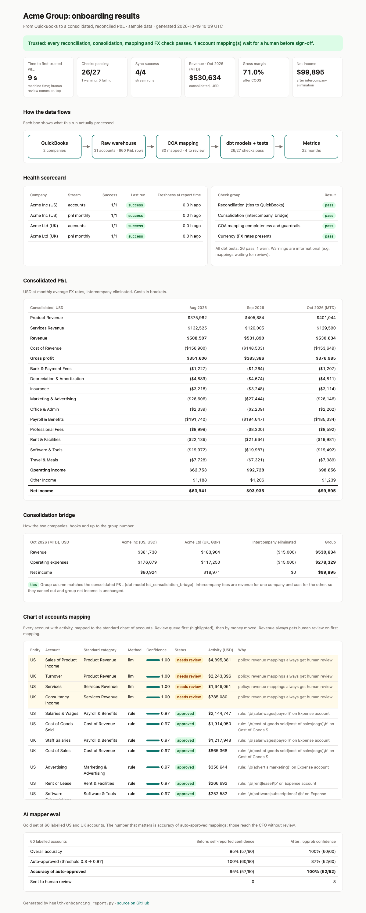
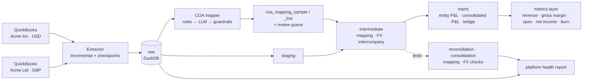

# Finance onboarding in a day

**Turns two companies' QuickBooks books into one trusted, combined monthly P&L (profit and loss statement), with automatic checks that prove every number matches the source.**

**[Results dashboard](https://kushajjee-tech.github.io/TaskForDT/)** · [Product brief (PRD)](docs/PRD.md) · [Data contract](docs/data_contract_pnl.yml) · [How AI agents should use the data](docs/ai_ready_interface.md)

## The problem

A new customer of an FP&A (financial planning) tool wants to see their numbers on day one. But accounting data is messy: every company names its accounts differently, uses its own currency and books payments between its own companies, so onboarding usually takes weeks of manual work.

## What I built

A working slice of that onboarding, run on a sample group of two companies (Acme Inc in the US, Acme Ltd in the UK) and tested against real QuickBooks sandbox companies.

| Piece | What it does |
|---|---|
| **QuickBooks connector** | Pulls the chart of accounts and the monthly P&L through the QuickBooks API. After the first full load, it only fetches what changed, and re-checks recent months because accountants edit the past. |
| **Warehouse + normalization** | Stores everything in a local DuckDB database (a single-file SQL database). Converts pounds to dollars at monthly average rates and removes payments between the two companies, so the group isn't double counted. |
| **Account mapping with AI, and its eval** | Maps each company's accounts to one standard chart of accounts (COA), e.g. "SaaS Tools" and "Software Subscriptions" both become *Software & Tools*. Simple rules first, then an LLM for the rest. Unsure answers, and all revenue accounts, go to a human. Measured on 60 labelled accounts: 100% of auto-approved mappings correct, up from 95%. |
| **dbt transformations** | dbt is a tool for building tables with version-controlled SQL. It turns raw data into the company P&Ls, the combined group P&L and one shared set of metric definitions (revenue, gross margin, net income...). |
| **Tests** | 27 automatic checks on every run. The key ones: every account and every month ties back to QuickBooks' own report to the cent, and payments between the companies cancel out exactly. |
| **Health report** | Sync success, data freshness, which checks pass, and which mappings wait for review, in a one-page [dashboard](https://kushajjee-tech.github.io/TaskForDT/). |

## Run it (sample data, no credentials)

Python 3.10 or newer recommended (3.9 works but prints an SSL warning on macOS).

```bash
python3 -m venv .venv && source .venv/bin/activate && pip install -r requirements.txt
cp .env.example .env
./run_onboarding.sh --fresh
```

Then open `reports/onboarding_report.html` in a browser. The pipeline itself runs in about 10 seconds; installing packages takes longer.



---

# For engineers

**See a check catch a real problem:**
```bash
make demo-edit   # simulates a back-dated edit OUTSIDE the lookback window → reconciliation fails
make onboard     # normal sync again → passes
```

Without an OpenAI key the mapper uses rules plus a weak fallback and sends the rest to review (the committed sample mapping means nothing needs mapping on a fresh clone). Add `OPENAI_API_KEY` to `.env` to use the LLM stage.

## Architecture



| Layer | Where | What happens |
|---|---|---|
| Extract + load | `extract/` | Accounts: incremental on `LastUpdatedTime` (inactive accounts included = soft deletes). P&L: full backfill once, then re-pull a trailing lookback window (reports have no "changed since" filter, and accountants back-date edits). |
| Map | `ai/` | Stage 1 rules, stage 2 LLM (JSON, temperature 0, confidence from logprobs), guardrails, risk-based review (revenue always reviewed), auto-approve above a calibrated threshold. Only new accounts are mapped. |
| Transform | `dbt/models/` | staging → intermediate (mapping, FX, intercompany) → marts (entity P&L, consolidated P&L, consolidation bridge, metrics). |
| Test | `dbt/tests/` + schema tests | 27 checks, incl. reconciliation to source, intercompany nets to zero, every line mapped, AI mappings can't flip revenue/expense, FX rates present. |
| Observe | `health/` | Sync success rate, freshness, test results, mappings awaiting review, time to first trusted P&L (`reports/platform_health.md`), plus the one-page HTML results report (`reports/onboarding_report.html`). |

## Run it on real QuickBooks sandboxes

1. In the Intuit developer portal, create an app (Development keys) and two sandbox companies (US and UK).
2. In the **OAuth 2.0 Playground**, authorize the app **once per company** (accounting scope) and copy each company's **Realm ID** and **Refresh token**.
3. Fill `.env`: `SOURCE_MODE=live`, `QBO_CLIENT_ID`, `QBO_CLIENT_SECRET`, `QBO_US_REALM_ID`, `QBO_US_REFRESH_TOKEN`, `QBO_UK_REALM_ID`, `QBO_UK_REFRESH_TOKEN`.
4. `./run_onboarding.sh --fresh`

Sample and live data never mix. Account ids are only unique within one QuickBooks company, so each mode has its own mapping file (`dbt/seeds/coa_mapping_sample.csv` is committed, `coa_mapping_live.csv` stays local), and dbt picks the right one from `SOURCE_MODE`. The warehouse holds one mode at a time: switching modes requires `--fresh`, otherwise the extractor stops with a clear message. To run the other mode without editing `.env`: `SOURCE_MODE=sample ./run_onboarding.sh --fresh`.

**What testing against the live API changed** (sample data was built from Intuit's documented format):
- Parent accounts with their own postings put those amounts in the report section's *header* row, not in a data row. The parser missed them, and `assert_net_income_ties_to_source` caught it (5 months off by the parent's direct amounts).
- Sandbox accounts can have `LastUpdatedTime` in the future, so the incremental cursor is capped at the run's start time; otherwise real edits would be skipped until that date.
- Account ids are only unique per company. Moving from sample data to a sandbox reused ids for different accounts (e.g. `us:80`), and the direction guardrail test caught a revenue mapping on a COGS account. The mapper now drops non-human mappings whose account id + name no longer match the warehouse.

Intuit rotates refresh tokens; the extractor saves the newest one to `state/tokens.json` after every refresh. Sandboxes contain no intercompany activity, so a seed (`dbt/seeds/intercompany_transactions.csv`) simulates a monthly management fee booked in both companies.

## The AI mapper and its eval

```bash
make eval-offline   # baseline: rules + fallback
make eval           # rules + LLM (needs OPENAI_API_KEY)
```

`evals/coa_gold.csv` holds 60 labelled accounts in US and UK styles. The eval reports overall accuracy, auto-approval rate and, most importantly, **accuracy of auto-approved mappings** (wrong auto-approvals reach the CFO without review). It also sweeps the auto-approve threshold and recommends one. Results: `evals/results_*.md`.

Design choices: rules before AI (cheap, deterministic), the LLM chooses only from the taxonomy, a deterministic guardrail blocks direction flips, and confidence comes from the model's token probabilities, not from what the model says about itself.

**How confidence works.** Each account gets its own small LLM call that returns `{"category": ...}` with `logprobs` on. Confidence is the probability the model gave to the tokens that spell out the chosen category, so a split decision (e.g. 70% Insurance vs 30% Payroll & Benefits) shows up as 0.70, not as the model calling itself "0.95 confident".

**Review policy (risk-based).** Not every mistake costs the same, so review isn't based only on confidence:

| Rule | Why |
|---|---|
| Revenue categories always go to human review on first mapping, whatever the confidence (unless a human mapped it) | Misclassified revenue is the costliest error: it moves top line, gross margin and growth, the first numbers a board reads |
| A mapping that flips direction (expense → revenue) always goes to review | Deterministic guardrail, also enforced as a dbt test |
| Otherwise auto-approve at confidence ≥ `AUTO_APPROVE_CONFIDENCE` (default 0.97, calibrated below) | Low-risk categories, where automation saves the most time |

Human-approved mappings are never overwritten, so each revenue account is reviewed once, at onboarding.

### What the eval taught us

| | Before | After |
|---|---|---|
| Confidence signal | Self-reported by the LLM (one batched call) | Token logprobs (one call per account) |
| Overall accuracy | 95% (57/60) | 100% (60/60) |
| Auto-approved | 100% (60/60) | 87% (52/60), the 8 sent to review are revenue (policy) |
| **Accuracy of auto-approved** | **95% (57/60)** | **100% (52/52)** |
| Threshold | 0.8 (a guess) | 0.97 (calibrated) |

1. **Self-reported confidence was useless.** All 60 mappings came back at 0.97-1.00, including the 3 wrong ones (two at 1.00). No threshold could have caught them.
2. **One of the errors was ours, not the model's.** The insurance rule sent "Health Insurance - Employees" to Insurance. Rules now skip employee-benefit names and leave them to the LLM.
3. **The other two (Design income, Workers Compensation) were correct after the switch** to one call per account with category names quoted exactly in the prompt. Both changes landed together, so we can't say which one fixed them.
4. **Calibration needs errors to calibrate against.** With logprobs, every threshold from 0.5 to 0.97 gives 100% auto-approved accuracy on this gold set, so the eval can't say where errors start. We pick the most conservative threshold that costs no automation (0.97, which also keeps the 0.97-confidence rules). 52/52 correct is still only ~93% at the lower end of a 95% confidence interval, so the next step is a bigger gold set with deliberately ambiguous accounts.

Full tables: [before](evals/results_llm_before.md), [after](evals/results_llm_after.md), [offline baseline](evals/results_offline.md) (rules only: 30% auto-approved, 18/18 correct).

## Key design decisions

- **Account × month × entity is the grain.** That's the grain FP&A plans and reports at.
- **Two sync patterns, on purpose.** Entity APIs support true incremental sync; reports don't, so a lookback window plus a full-range reconciliation total guards against missed back-dated edits.
- **Reconcile to the source, not to ourselves.** Totals come from a separate QuickBooks report call, so the test checks our pipeline against QuickBooks, not against its own output.
- **P&L uses monthly average FX rates.** Balance sheet would use month-end rates (out of scope).
- **Metrics are defined once** (`mtr_monthly_metrics`) so dashboards, forecasts and AI agents use the same math.

## Out of scope / next steps

Balance sheet and cash flow (cash-based burn), month-end FX and CTA, real intercompany matching from ERP intercompany accounts, departments/classes, a review UI for the mapping queue, NetSuite and Xero connectors behind the same raw contract, orchestration (Airflow/Dagster), and an MCP or API layer exposing the metrics to AI agents. See `docs/`.

## Repo map

```
extract/   QuickBooks client (live + sample), parser, loader, CLI
ai/        COA mapper (rules → LLM → guardrails) and eval
evals/     gold set + eval results
dbt/       models (staging, intermediate, marts), seeds, tests
health/    platform health report + one-page HTML results report
docs/      PRD (incl. acceptance criteria), data contract, AI-ready interface, dashboard (index.html)
```
